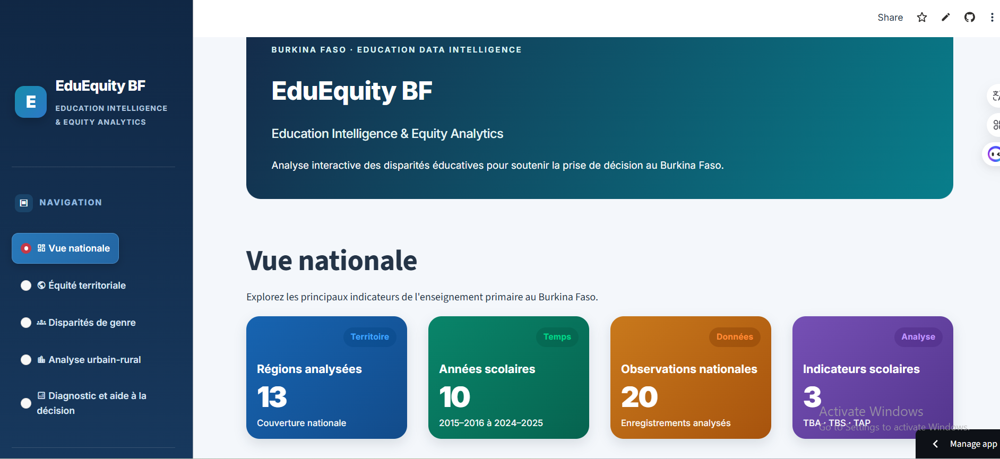
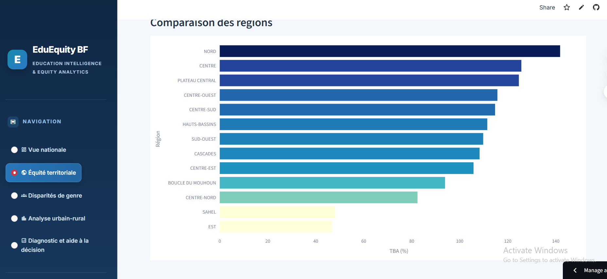
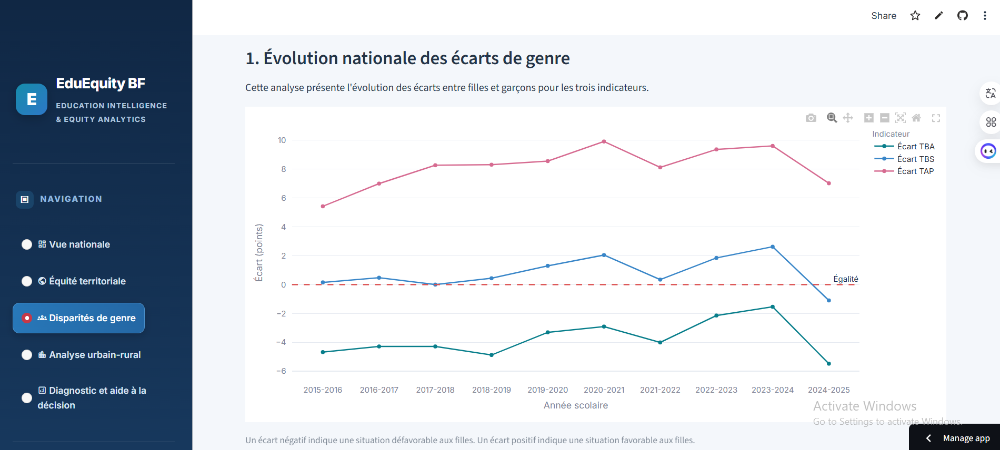
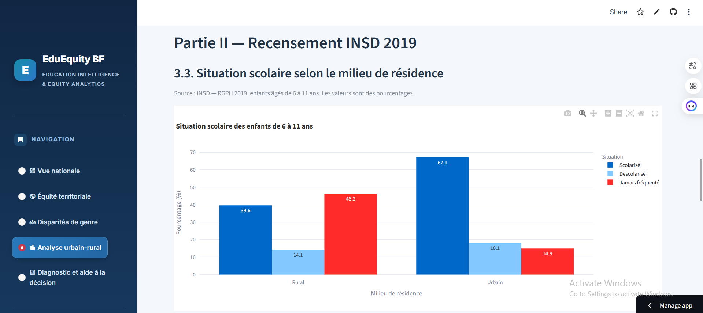
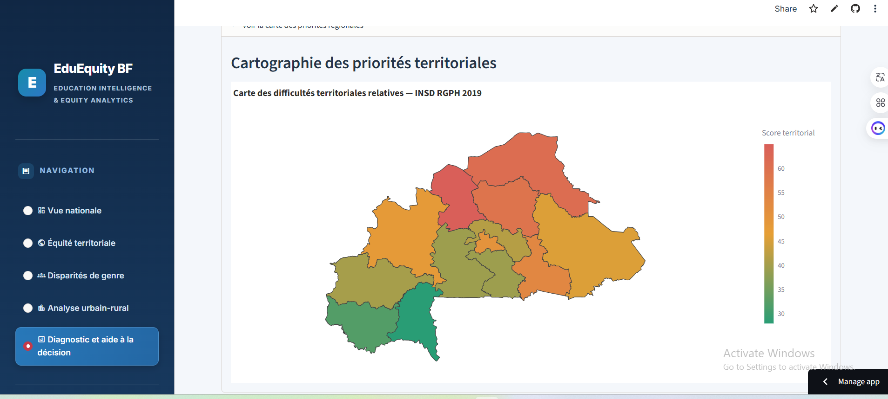

# EduEquity BF 🇧🇫
### Education Intelligence & Equity Analytics

EduEquity BF est un tableau de bord interactif consacré à l'analyse des disparités éducatives au Burkina Faso. Il vise à faciliter l'exploration des indicateurs scolaires et à soutenir la prise de décision fondée sur les données.

🌐 Application en ligne : https://eduequity-bf.streamlit.app/

## 🎯 Objectifs du projet

Analyser l'évolution des principaux indicateurs de l'enseignement primaire.
Examiner les disparités éducatives entre les régions.
Étudier les écarts entre filles et garçons.
Comparer les situations en milieu urbain et rural.
Mettre en évidence les inégalités et les enjeux prioritaires.

## 📊 Fonctionnalités

Le tableau de bord comprend cinq modules :

1. Vue nationale– Exploration des principaux indicateurs scolaires à l'échelle nationale.
2. Équité territoriale – Comparaison des performances et des disparités entre les régions.
3. Disparités de genre – Analyse des écarts entre filles et garçons.
4. Analyse urbain-rural – Comparaison des indicateurs selon le milieu de résidence.
5. Diagnostic et aide à la décision – Exploration des principaux constats pour orienter les décisions.

## 📚 Données utilisées

Le projet exploite des données statistiques relatives à l'éducation au Burkina Faso, couvrant les années scolaires 2015-2016 à 2024-2025.

Données éducatives : DGESS.
Données démographiques : INSD, notamment le RGPH 2019.
Couverture territoriale : 13 régions.
Période d'analyse : 10 années scolaires.

Les analyses reposent sur les données disponibles dans le projet. Les résultats doivent être interprétés en tenant compte de leur période de couverture et de leurs limites.

## 🛠️ Technologies utilisées

Python
Streamlit
Pandas
Plotly

## 📁 Structure du projet

```text
EduEquity_BF/
├── data/
├── outputs/
├── src/
│   └── 06_interactive_visualization/
│       ├── app.py
│       ├── config.py
│       └── assets/
├── submission/
├── requirements.txt
├── .gitignore
└── main.py
```

## 🚀 Installation et exécution locale

Cloner le dépôt :

```bash
git clone https://github.com/rasmane226/EduEquity_BF.git
cd EduEquity_BF
```

Installer les dépendances :

```bash
pip install -r requirements.txt
```

Lancer l'application :

```bash
python -m streamlit run src/06_interactive_visualization/app.py
```

## ☁️ Déploiement

L'application est hébergée sur Streamlit Community Cloud :

https://eduequity-bf.streamlit.app/

Le code source est disponible sur GitHub :

https://github.com/rasmane226/EduEquity_BF

## 🎯 Finalité

EduEquity BF ambitionne de transformer les données éducatives en informations accessibles et exploitables pour mieux comprendre les inégalités scolaires au Burkina Faso.

---

Projet d'analyse de données et de visualisation consacré à l'équité éducative au Burkina Faso.


## 🖥️ Aperçu du tableau de bord

### Vue nationale


### Analyse territoriale


### Disparités de genre


### Analyse urbain-rural


### Cartographie des priorités territoriales


🌐 Explorer l'application : https://eduequity-bf.streamlit.app/
